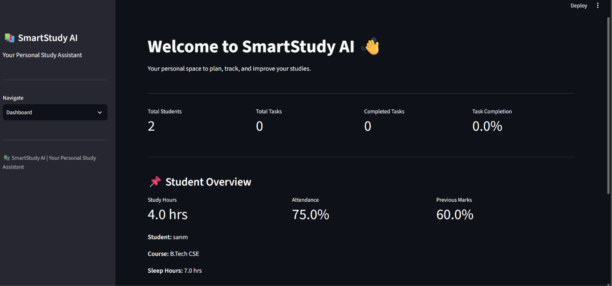
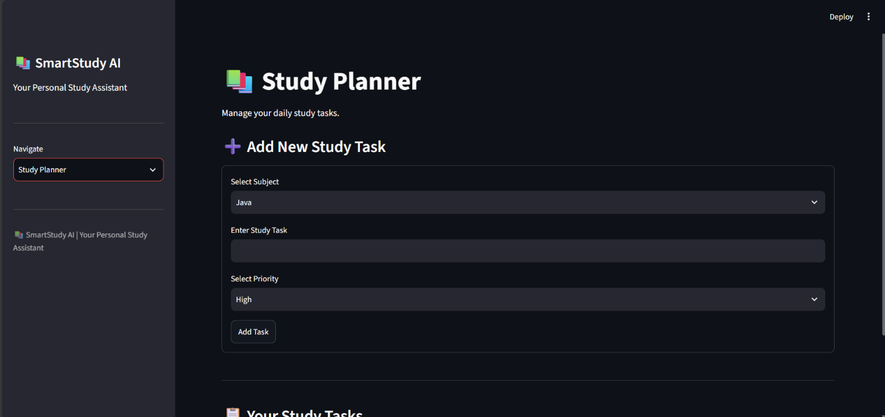
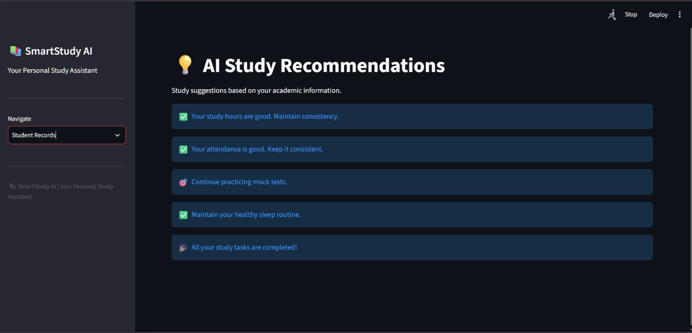

# SmartStudy AI 📚

SmartStudy AI is a Python-based student performance and study management application built using Streamlit, SQLite, and Machine Learning.

## Features

- **Dashboard:** Overview of student information and study task progress.
- **Student Profile:** Save and manage student academic details.
- **Performance Predictor:** Predict exam scores using a trained Machine Learning model.
- **Study Planner:** Create, edit, delete, and track study tasks.
- **Analytics:** Visualize student performance and study progress.
- **AI Recommendations:** Get personalized, rule-based study recommendations.
- **What-If Simulator:** Explore how changes in study habits may affect predicted scores.
- **Student Records:** View saved student information.

## Technologies Used

- Python
- Streamlit
- SQLite
- Pandas
- Scikit-learn
- Joblib
- Matplotlib

## Project Structure

```text
SmartStudyAI/
├── app.py
├── database.py
├── requirements.txt
├── smartstudy.db
├── dataset/
├── ml_model/
└── README.md
```

## Installation and Setup

1. Clone the repository:

```bash
git clone YOUR_GITHUB_REPOSITORY_URL
```

2. Navigate to the project folder:

```bash
cd SmartStudyAI
```

3. Create and activate a virtual environment:

```bash
python -m venv venv
venv\Scripts\activate
```

4. Install dependencies:

```bash
pip install -r requirements.txt
```

5. Run the application:

```bash
streamlit run app.py
```

## Machine Learning

The application uses a trained Linear Regression model to estimate student exam scores based on study hours, attendance, previous scores, and sleep hours.

## Project Status

Core application features implemented and tested.

## Application Screenshots

### Dashboard



### Study Planner



### AI RECOMMENDATION



## Author

Sweta Rakesh Surve

B.Tech – Computer Science and Engineering
